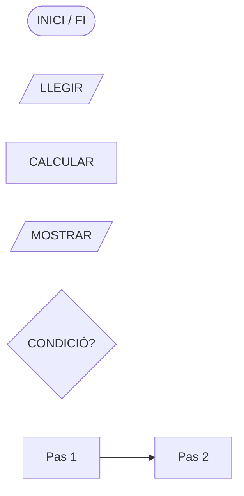
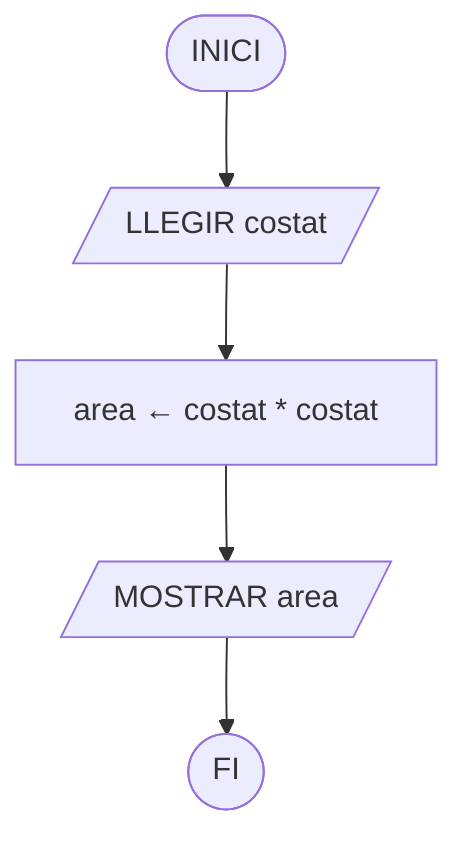
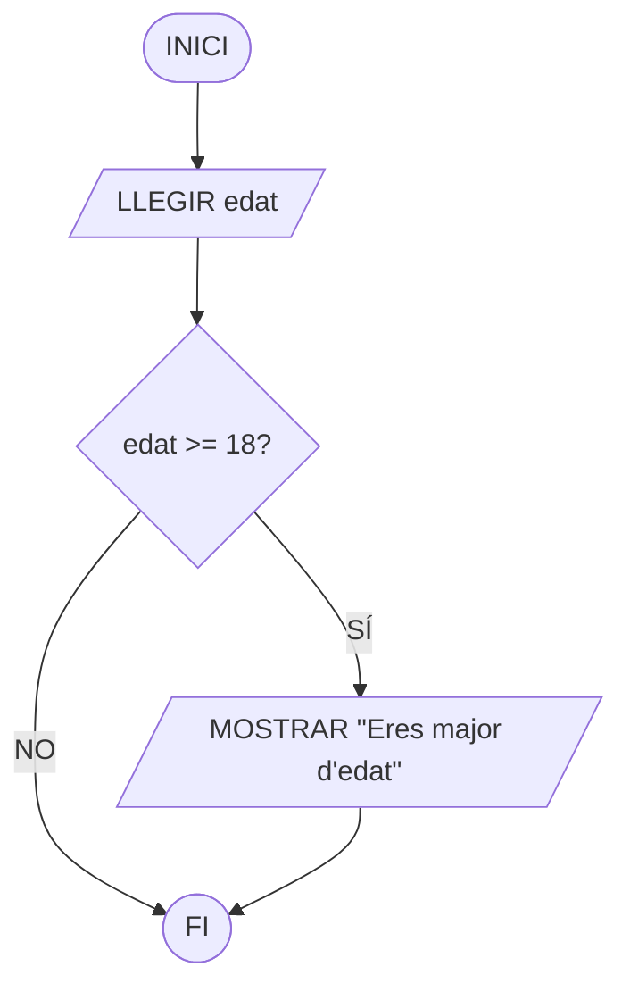
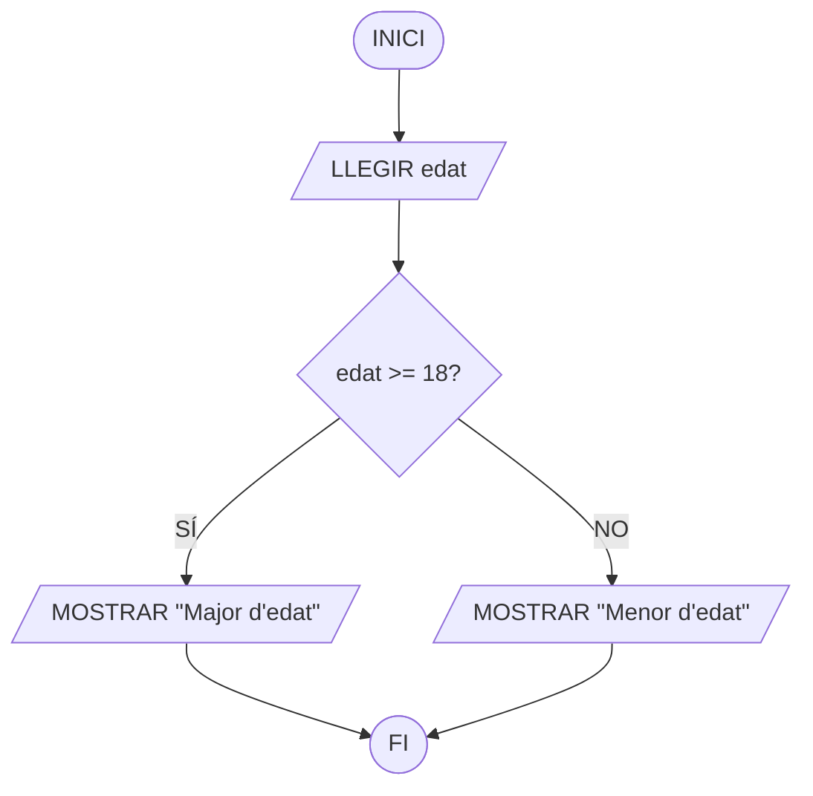
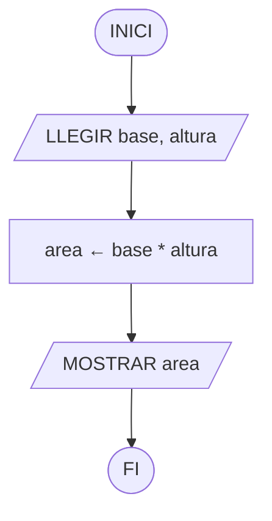
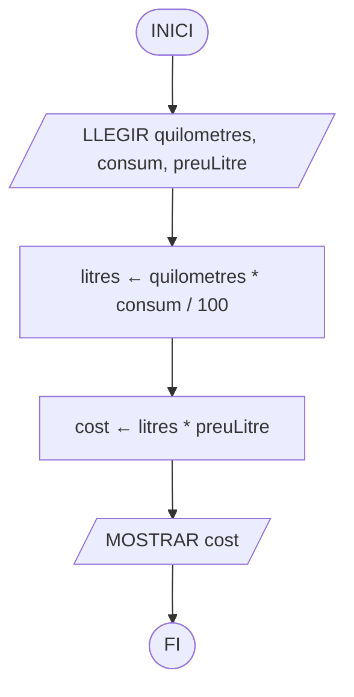
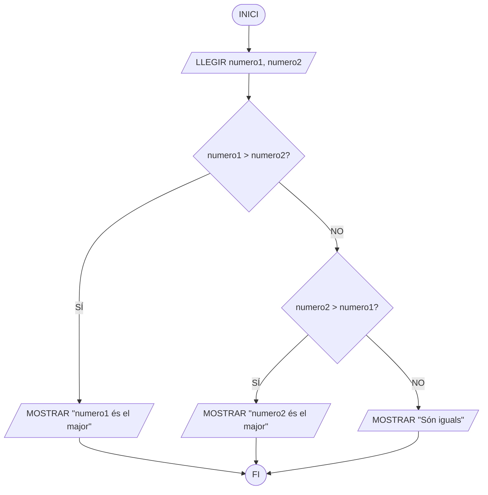
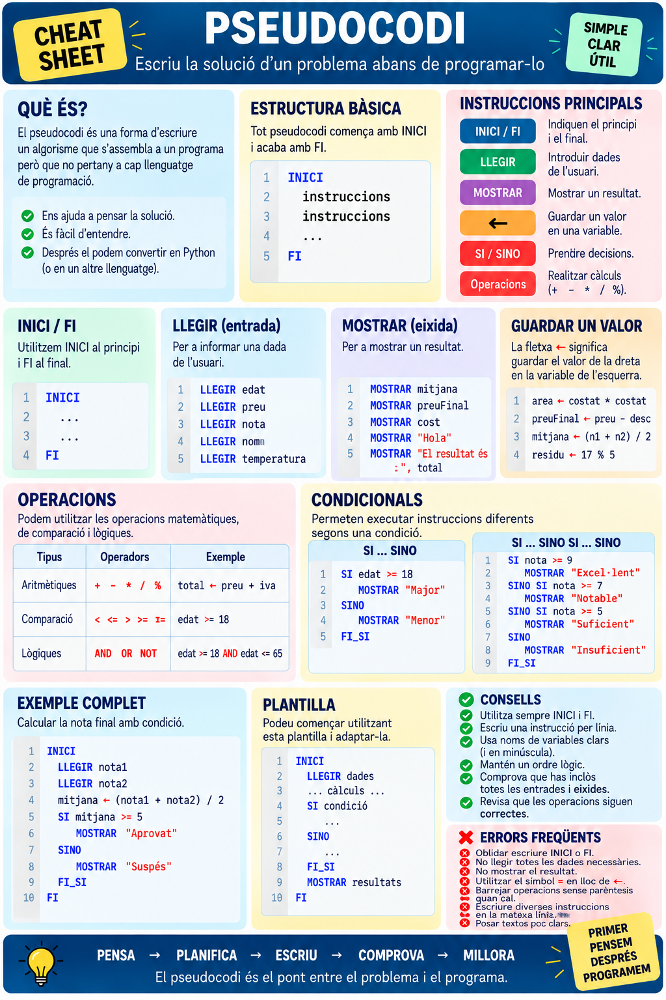
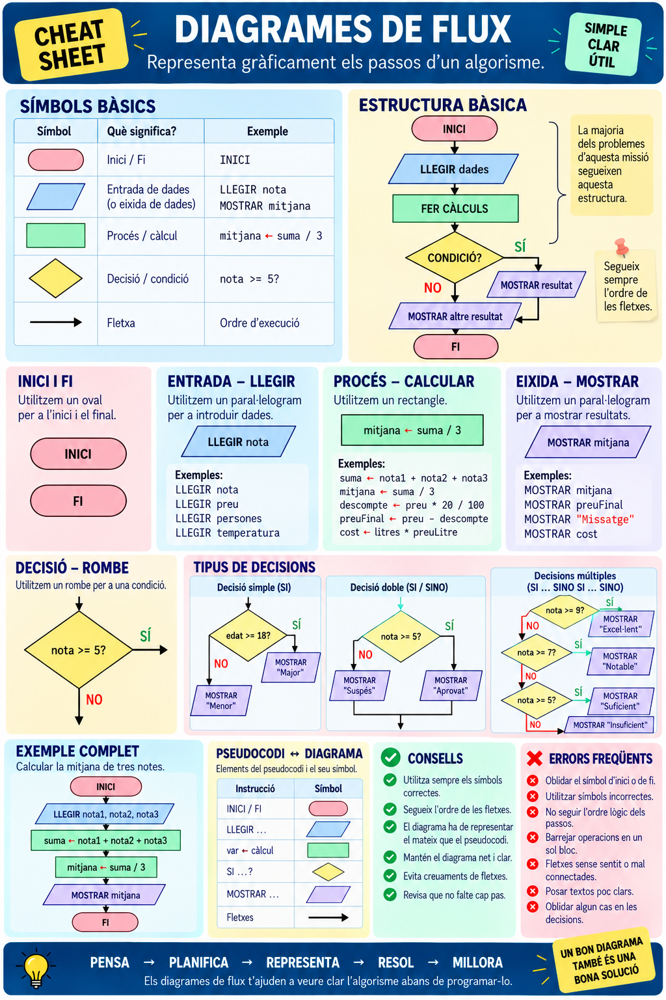

# Pseudocodi i diagrames de flux

Abans de començar a programar és important aprendre a **pensar la solució**.

Quan tenim un problema, podem seguir aquest procés:

```text
PROBLEMA
   ↓
ANALITZAR
   ↓
CREAR L'ALGORISME
   ↓
ESCRIURE EL PSEUDOCODI
   ↓
FER EL DIAGRAMA DE FLUX
   ↓
PROGRAMAR
```

El **pseudocodi** i els **diagrames de flux** són dues formes diferents de representar el mateix algorisme.

Els exercicis que treballarem necessiten començar amb problemes seqüencials d'entrada, càlcul i eixida, però després incorporen decisions simples i dobles, comparacions entre diversos valors i problemes amb diverses condicions.  

# 1. Pseudocodi

El **pseudocodi** és una manera d'escriure un algorisme utilitzant instruccions senzilles i fàcils d'entendre.

S'assembla a un programa, però **no és un llenguatge de programació** i, per tant, no es pot executar directament.

Per exemple:

```text
INICI

    LLEGIR preu
    descompte ← preu * 20 / 100
    preuFinal ← preu - descompte
    MOSTRAR preuFinal

FI
```

La idea és solucionar primer el problema sense preocupar-nos encara per la sintaxi de Python.

## Estructura bàsica

Un pseudocodi senzill tindrà normalment aquesta estructura:

```text
INICI

    LLEGIR dades

    REALITZAR operacions

    MOSTRAR resultats

FI
```

És el mateix esquema que ja coneixem:

```text
ENTRADA → PROCÉS → EIXIDA
```

## Entrada de dades: LLEGIR

Utilitzem `LLEGIR` quan necessitem obtindre una dada de l'usuari.

```text
LLEGIR edat
LLEGIR preu
LLEGIR nota1
LLEGIR nota2
```

La dada queda guardada en una **variable** perquè puguem utilitzar-la després.

Per exemple:

```text
LLEGIR costat
```

significa:

> Demana un valor a l'usuari i guarda'l en la variable `costat`.

## Guardar valors i fer càlculs

Utilitzarem la fletxa `←` per indicar que guardem un valor en una variable.

```text
area ← costat * costat
```

Primer es calcula:

```text
costat * costat
```

i el resultat es guarda en:

```text
area
```

Podem encadenar diverses operacions:

```text
LLEGIR anys

dies ← anys * 365
hores ← dies * 24

MOSTRAR hores
```

Els materials de la unitat utilitzen precisament aquesta idea: les variables emmagatzemen informació i les instruccions de procés realitzen operacions sobre elles. 

## Operacions

Les operacions que necessitarem són:

| Tipus        | Operadors              | Exemple                     |
| ------------ | ---------------------- | --------------------------- |
| Aritmètiques | `+  -  *  /  %`        | `resta ← a - b`             |
| Comparació   | `<  <=  >  >=  ==  !=` | `edat >= 18`                |
| Lògiques     | `AND  OR  NOT`         | `edat >= 18 AND edat <= 65` |

L'operador `%` calcula el **residu d'una divisió**.

Per exemple:

```text
residu ← 17 % 5
```

El resultat serà `2`.

Les comparacions i operacions lògiques seran especialment útils quan introduïm decisions. El material base també diferencia operacions aritmètiques, relacionals i lògiques. 

## Eixida de dades: MOSTRAR

Utilitzem `MOSTRAR` quan volem presentar informació a l'usuari.

```text
MOSTRAR area
```

També podem mostrar text:

```text
MOSTRAR "Hola"
```

o combinar text i variables:

```text
MOSTRAR "El resultat és: ", resultat
```

L'entrada i l'eixida són les que permeten que l'usuari interactue amb el programa: introduïm informació, el programa la processa i finalment mostra un resultat. 

# 2. Prendre decisions

No tots els programes executen sempre exactament les mateixes instruccions.

De vegades necessitem prendre una decisió:

```text
Si l'edat és 18 o més
    → mostrar "Major d'edat"
```

Per fer-ho utilitzem una **condició**.

```text
edat >= 18
```

Una condició només pot tindre dos resultats:

```text
CERT
FALS
```

Les estructures de control permeten modificar l'ordre normal d'execució d'un algorisme segons aquestes condicions. 

## SI — Decisió simple

Utilitzem una decisió simple quan volem executar una acció **només si es compleix una condició**.

```text
SI condició LLAVORS
    instruccions
FI_SI
```

Per exemple:

```text
LLEGIR edat

SI edat >= 18 LLAVORS
    MOSTRAR "Eres major d'edat"
FI_SI
```

Si l'edat és menor de 18, no es mostra res i el programa continua.

Aquesta és l'estructura alternativa simple descrita als materials de la unitat. 

## SI / SINO — Decisió doble

Quan volem fer una cosa si la condició és certa i una altra si és falsa:

```text
SI condició LLAVORS

    instruccions

SINO

    altres instruccions

FI_SI
```

Per exemple:

```text
LLEGIR edat

SI edat >= 18 LLAVORS
    MOSTRAR "Eres major d'edat"
SINO
    MOSTRAR "Eres menor d'edat"
FI_SI
```

En aquest cas **sempre s'executarà un dels dos camins**. 

## Diverses decisions

També podem necessitar comprovar més d'una condició.

Per exemple:

```text
LLEGIR nota

SI nota < 5 LLAVORS
    MOSTRAR "Suspés"
SINO
    SI nota < 7 LLAVORS
        MOSTRAR "Aprovat"
    SINO
        MOSTRAR "Notable o superior"
    FI_SI
FI_SI
```

Açò ens permet resoldre problemes amb **diversos casos possibles**, com convertir una nota numèrica en una qualificació o comparar diversos números, que apareixen en els exercicis de nivell avançat. 

----

# 3. Diagrames de flux

Un **diagrama de flux** o **ordinograma** és la representació gràfica d'un algorisme.

En lloc d'escriure únicament instruccions, utilitzem **formes i fletxes** per mostrar visualment l'ordre d'execució.

Són especialment útils per entendre com funcionarà un programa abans d'escriure el codi. 

## Símbols principals

| Símbol | Significat | Exemple |
| --- | --- | --- |
| Oval | Inici / Fi | `INICI` |
| Paral·lelogram | Entrada | `LLEGIR edat` |
| Rectangle | Procés | `area ← costat * costat` |
| Paral·lelogram | Eixida | `MOSTRAR area` |
| Rombe | Decisió | `edat >= 18?` |
| Fletxa | Ordre d'execució | `↓` |

### Representació dels símbols



Per tant:

```text
LLEGIR        → Paral·lelogram
CALCULAR      → Rectangle
MOSTRAR       → Paral·lelogram
PREGUNTAR     → Rombe
```


El material de referència utilitza rectangles per als processos, paral·lelograms per a entrada/eixida i rombes per a les condicions.   

## Diagrama seqüencial

Un problema sense decisions segueix un únic camí.

Per exemple, calcular l'àrea d'un quadrat:



Observeu la correspondència:

```text
LLEGIR costat              → Entrada
area ← costat * costat     → Procés
MOSTRAR area               → Eixida
```

## Diagrama amb una decisió

Quan apareix una condició utilitzem un **rombe**.



Del rombe ixen dos camins:

```text
SÍ → la condició es compleix.
NO → la condició no es compleix.
```

## Diagrama amb decisió doble

Si volem fer una acció diferent en cada cas:



Els dos camins tornen a unir-se i el programa continua. Aquesta és també l'estructura que mostra el diagrama de decisió doble del material original. 

# 4. Del pseudocodi al diagrama de flux

No són dues solucions diferents.

**Representen el mateix algorisme de dues maneres diferents.**

Per exemple:

```text
INICI

    LLEGIR base
    LLEGIR altura

    area ← base * altura

    MOSTRAR area

FI
```

es converteix directament en:



Una bona comprovació és llegir el diagrama de dalt a baix. Hauríem de poder reconstruir pràcticament el pseudocodi.

# 5. Com resoldre un problema

Quan ens donen un enunciat, **no comencem dibuixant formes**.

Primer pensem.

### Pas 1. Identificar les entrades

Quines dades necessitem?

```text
ENTRADA
preu
descompte
```

### Pas 2. Identificar l'eixida

Què ens demanen calcular o mostrar?

```text
EIXIDA
preuFinal
```

### Pas 3. Pensar el procés

Quins càlculs necessitem?

```text
importDescompte ← preu * descompte / 100
preuFinal ← preu - importDescompte
```

### Pas 4. Comprovar si hi ha decisions

Hem de preguntar alguna cosa?

```text
edat >= 18?
numero1 > numero2?
nota >= 5?
```

Si la resposta és sí, necessitarem una estructura `SI` i un **rombe** en el diagrama.

### Pas 5. Escriure el pseudocodi

Ordenem totes les instruccions.

### Pas 6. Fer el diagrama

Transformem cada instrucció en el símbol corresponent.

---

# 6. Exemple complet 1 — Cost d'un viatge

Volem calcular quant ens costarà el combustible d'un viatge.

L'usuari introduirà:

* quilòmetres del viatge;
* consum del vehicle en litres cada 100 km;
* preu d'un litre de combustible.

## Anàlisi

```text
ENTRADES
quilometres
consum
preuLitre

PROCÉS
Calcular els litres necessaris.
Calcular el cost.

EIXIDA
cost
```

## Pseudocodi

```text
INICI

    LLEGIR quilometres
    LLEGIR consum
    LLEGIR preuLitre

    litres ← quilometres * consum / 100
    cost ← litres * preuLitre

    MOSTRAR cost

FI
```

## Diagrama de flux



Aquest exemple és **seqüencial**: totes les instruccions s'executen una darrere de l'altra.

---

# 7. Exemple complet 2 — Quin número és major?

Volem llegir dos números i indicar quin és major o si són iguals.

Ara tenim tres possibilitats:

```text
numero1 > numero2
numero2 > numero1
numero1 == numero2
```

Per tant, necessitem prendre decisions.

## Anàlisi

```text
ENTRADES
numero1
numero2

PROCÉS
Comparar els dos números.

EIXIDA
Indicar quin és major o si són iguals.
```

## Pseudocodi

```text
INICI

    LLEGIR numero1
    LLEGIR numero2

    SI numero1 > numero2 LLAVORS

        MOSTRAR numero1, " és el major"

    SINO

        SI numero2 > numero1 LLAVORS

            MOSTRAR numero2, " és el major"

        SINO

            MOSTRAR "Els dos números són iguals"

        FI_SI

    FI_SI

FI
```

## Diagrama de flux



En aquest segon exemple ja no tenim un únic camí. El programa **pren una decisió segons els valors introduïts**.

> **Idea clau:** primer entenem el problema, després construïm l'algorisme. El pseudocodi l'expressa amb instruccions i el diagrama de flux representa visualment aquestes mateixes instruccions.

---

## Resumint

---



---





# 8. Estructures repetitives: els bucles

Fins ara hem vist algorismes que executen instruccions una darrere de l'altra i algorismes que prenen decisions mitjançant `SI` i `SINO`.

Però què passa si necessitem repetir una mateixa acció diverses vegades?

Per exemple, si volem mostrar els números de l'1 al 5, podríem escriure:

```
MOSTRAR 1
MOSTRAR 2
MOSTRAR 3
MOSTRAR 4
MOSTRAR 5
```

Aquesta solució funciona, però què passaria si volguérem mostrar els números de l'1 al 1.000?

Per evitar repetir les mateixes instruccions, utilitzem els bucles.

Un bucle és una estructura de control que permet executar un conjunt d'instruccions diverses vegades.

## El bucle MENTRE

Utilitzem `MENTRE` quan volem repetir unes instruccions mentre es complisca una condició.

La seua estructura és:

```
MENTRE condició FER
    instruccions
FI_MENTRE
```

El funcionament és el següent:

1. Es comprova la condició.
2. Si és `CERT`, s'executen les instruccions del bucle.
3. En acabar, es torna a comprovar la condició.
4. Si continua sent `CERT`, les instruccions es repetixen.
5. Quan la condició és `FALS`, el bucle acaba i el programa continua.

Important: si la condició és falsa des del principi, les instruccions del bucle no s'executen cap vegada.

## Exemple 1. Mostrar els números de l'1 al 5

Volem mostrar els números de l'1 al 5 utilitzant un bucle.

Pseudocodi

```
INICI

    comptador ← 1

    MENTRE comptador <= 5 FER

        MOSTRAR comptador
        comptador ← comptador + 1

    FI_MENTRE

FI
```

Resultat

```
1
2
3
4
5
```

Com funciona?

- `comptador ← 1`: establim el valor inicial.
- `comptador <= 5`: comprovem si hem de continuar repetint.
- `MOSTRAR comptador`: mostrem el valor actual.
- `comptador ← comptador + 1`: incrementem el comptador en una unitat.

Quan `comptador` arriba a 6, la condició `6 <= 5` és `FALS` i el bucle acaba.

## Seguiment d'un bucle

Per entendre millor com funciona, podem fer una taula de seguiment o traça.

Aquesta taula mostra com canvien les variables durant l'execució de l'algorisme.

| Iteració | Comptador | `comptador <= 5` | Acció          |
| -------- | --------- | ---------------- | -------------- |
| 1        | 1         | CERT             | Mostra 1       |
| 2        | 2         | CERT             | Mostra 2       |
| 3        | 3         | CERT             | Mostra 3       |
| 4        | 4         | CERT             | Mostra 4       |
| 5        | 5         | CERT             | Mostra 5       |
| 6        | 6         | FALS             | Acaba el bucle |

Observa que la sisena comprovació no executa les instruccions, perquè la condició ja és falsa.

Per tant, el bucle s'ha executat cinc vegades.

## Diagrama de flux d'un bucle

En un diagrama de flux, un bucle es representa mitjançant un rombe que comprova una condició i una fletxa que torna a aquest rombe.

\#chatgpt-mermaid-\_r_51n\_{font-family:-apple-system-body,ui-sans-serif,-apple-system,system-ui,"Segoe UI",Helvetica,"Apple Color Emoji",Arial,sans-serif,"Segoe UI Emoji","Segoe UI Symbol";font-size:16px;fill:rgb(13, 13, 13);}@keyframes edge-animation-frame{from{stroke-dashoffset:0;}}@keyframes dash{to{stroke-dashoffset:0;}}#chatgpt-mermaid-\_r_51n\_ .edge-animation-slow{stroke-dasharray:9,5!important;stroke-dashoffset:900;animation:dash 50s linear infinite;stroke-linecap:round;}#chatgpt-mermaid-\_r_51n\_ .edge-animation-fast{stroke-dasharray:9,5!important;stroke-dashoffset:900;animation:dash 20s linear infinite;stroke-linecap:round;}#chatgpt-mermaid-\_r_51n\_ .error-icon{fill:rgb(243, 243, 243);}#chatgpt-mermaid-\_r_51n\_ .error-text{fill:rgb(13, 13, 13);stroke:rgb(13, 13, 13);}#chatgpt-mermaid-\_r_51n\_ .edge-thickness-normal{stroke-width:1px;}#chatgpt-mermaid-\_r_51n\_ .edge-thickness-thick{stroke-width:3.5px;}#chatgpt-mermaid-\_r_51n\_ .edge-pattern-solid{stroke-dasharray:0;}#chatgpt-mermaid-\_r_51n\_ .edge-thickness-invisible{stroke-width:0;fill:none;}#chatgpt-mermaid-\_r_51n\_ .edge-pattern-dashed{stroke-dasharray:3;}#chatgpt-mermaid-\_r_51n\_ .edge-pattern-dotted{stroke-dasharray:2;}#chatgpt-mermaid-\_r_51n\_ .marker{fill:rgb(143, 143, 143);stroke:rgb(143, 143, 143);}#chatgpt-mermaid-\_r_51n\_ .marker.cross{stroke:rgb(143, 143, 143);}#chatgpt-mermaid-\_r_51n\_ svg{font-family:-apple-system-body,ui-sans-serif,-apple-system,system-ui,"Segoe UI",Helvetica,"Apple Color Emoji",Arial,sans-serif,"Segoe UI Emoji","Segoe UI Symbol";font-size:16px;}#chatgpt-mermaid-\_r_51n\_ p{margin:0;}#chatgpt-mermaid-\_r_51n\_ .label{font-family:-apple-system-body,ui-sans-serif,-apple-system,system-ui,"Segoe UI",Helvetica,"Apple Color Emoji",Arial,sans-serif,"Segoe UI Emoji","Segoe UI Symbol";color:rgb(13, 13, 13);}#chatgpt-mermaid-\_r_51n\_ .cluster-label text{fill:rgb(13, 13, 13);}#chatgpt-mermaid-\_r_51n\_ .cluster-label span{color:rgb(13, 13, 13);}#chatgpt-mermaid-\_r_51n\_ .cluster-label span p{background-color:transparent;}#chatgpt-mermaid-\_r_51n\_ .label text,#chatgpt-mermaid-\_r_51n\_ span{fill:rgb(13, 13, 13);color:rgb(13, 13, 13);}#chatgpt-mermaid-\_r_51n\_ .node rect,#chatgpt-mermaid-\_r_51n\_ .node circle,#chatgpt-mermaid-\_r_51n\_ .node ellipse,#chatgpt-mermaid-\_r_51n\_ .node polygon,#chatgpt-mermaid-\_r_51n\_ .node path{fill:rgb(222, 234, 251);stroke:rgb(83, 154, 248);stroke-width:1px;}#chatgpt-mermaid-\_r_51n\_ .rough-node .label text,#chatgpt-mermaid-\_r_51n\_ .node .label text,#chatgpt-mermaid-\_r_51n\_ .image-shape .label,#chatgpt-mermaid-\_r_51n\_ .icon-shape .label{text-anchor:middle;}#chatgpt-mermaid-\_r_51n\_ .node .katex path{fill:#000;stroke:#000;stroke-width:1px;}#chatgpt-mermaid-\_r_51n\_ .rough-node .label,#chatgpt-mermaid-\_r_51n\_ .node .label,#chatgpt-mermaid-\_r_51n\_ .image-shape .label,#chatgpt-mermaid-\_r_51n\_ .icon-shape .label{text-align:center;}#chatgpt-mermaid-\_r_51n\_ .node.clickable{cursor:pointer;}#chatgpt-mermaid-\_r_51n\_ .root .anchor path{fill:rgb(143, 143, 143)!important;stroke-width:0;stroke:rgb(143, 143, 143);}#chatgpt-mermaid-\_r_51n\_ .arrowheadPath{fill:rgb(143, 143, 143);}#chatgpt-mermaid-\_r_51n\_ .edgePath .path{stroke:rgb(143, 143, 143);stroke-width:1px;}#chatgpt-mermaid-\_r_51n\_ .flowchart-link{stroke:rgb(143, 143, 143);fill:none;}#chatgpt-mermaid-\_r_51n\_ .edgeLabel{background-color:rgb(252, 252, 252);text-align:center;}#chatgpt-mermaid-\_r_51n\_ .edgeLabel p{background-color:rgb(252, 252, 252);}#chatgpt-mermaid-\_r_51n\_ .edgeLabel rect{opacity:0.5;background-color:rgb(252, 252, 252);fill:rgb(252, 252, 252);}#chatgpt-mermaid-\_r_51n\_ .labelBkg{background-color:rgba(252, 252, 252, 0.5);}#chatgpt-mermaid-\_r_51n\_ .cluster rect{fill:rgb(243, 243, 243);stroke:rgba(0, 0, 0, 0.1);stroke-width:1px;}#chatgpt-mermaid-\_r_51n\_ .cluster text{fill:rgb(13, 13, 13);}#chatgpt-mermaid-\_r_51n\_ .cluster span{color:rgb(13, 13, 13);}#chatgpt-mermaid-\_r_51n\_ div.mermaidTooltip{position:absolute;text-align:center;max-width:200px;padding:2px;font-family:-apple-system-body,ui-sans-serif,-apple-system,system-ui,"Segoe UI",Helvetica,"Apple Color Emoji",Arial,sans-serif,"Segoe UI Emoji","Segoe UI Symbol";font-size:12px;background:rgb(243, 243, 243);border:1px solid rgba(0, 0, 0, 0.1);border-radius:2px;pointer-events:none;z-index:100;}#chatgpt-mermaid-\_r_51n\_ .flowchartTitleText{text-anchor:middle;font-size:18px;fill:rgb(13, 13, 13);}#chatgpt-mermaid-\_r_51n\_ rect.text{fill:none;stroke-width:0;}#chatgpt-mermaid-\_r_51n\_ .icon-shape,#chatgpt-mermaid-\_r_51n\_ .image-shape{background-color:rgb(252, 252, 252);text-align:center;}#chatgpt-mermaid-\_r_51n\_ .icon-shape p,#chatgpt-mermaid-\_r_51n\_ .image-shape p{background-color:rgb(252, 252, 252);padding:2px;}#chatgpt-mermaid-\_r_51n\_ .icon-shape .label rect,#chatgpt-mermaid-\_r_51n\_ .image-shape .label rect{opacity:0.5;background-color:rgb(252, 252, 252);fill:rgb(252, 252, 252);}#chatgpt-mermaid-\_r_51n\_ .label-icon{display:inline-block;height:1em;overflow:visible;vertical-align:-0.125em;}#chatgpt-mermaid-\_r_51n\_ .node .label-icon path{fill:currentColor;stroke:revert;stroke-width:revert;}#chatgpt-mermaid-\_r_51n\_ .node .neo-node{stroke:rgb(83, 154, 248);}#chatgpt-mermaid-\_r_51n\_ [data-look="neo"].node rect,#chatgpt-mermaid-\_r_51n\_ [data-look="neo"].cluster rect,#chatgpt-mermaid-\_r_51n\_ [data-look="neo"].node polygon{stroke:url(#chatgpt-mermaid-\_r_51n\_-gradient);filter:drop-shadow( 1px 2px 2px rgba(185,185,185,1));}#chatgpt-mermaid-\_r_51n\_ [data-look="neo"].swimlane.cluster rect{filter:none;}#chatgpt-mermaid-\_r_51n\_ [data-look="neo"].node path{stroke:url(#chatgpt-mermaid-\_r_51n\_-gradient);stroke-width:1px;}#chatgpt-mermaid-\_r_51n\_ [data-look="neo"].node .outer-path{filter:drop-shadow( 1px 2px 2px rgba(185,185,185,1));}#chatgpt-mermaid-\_r_51n\_ [data-look="neo"].node .neo-line path{stroke:rgb(83, 154, 248);filter:none;}#chatgpt-mermaid-\_r_51n\_ [data-look="neo"].node circle{stroke:url(#chatgpt-mermaid-\_r_51n\_-gradient);filter:drop-shadow( 1px 2px 2px rgba(185,185,185,1));}#chatgpt-mermaid-\_r_51n\_ [data-look="neo"].node circle .state-start{fill:#000000;}#chatgpt-mermaid-\_r_51n\_ [data-look="neo"].icon-shape .icon{fill:url(#chatgpt-mermaid-\_r_51n\_-gradient);filter:drop-shadow( 1px 2px 2px rgba(185,185,185,1));}#chatgpt-mermaid-\_r_51n\_ [data-look="neo"].icon-shape .icon-neo path{stroke:url(#chatgpt-mermaid-\_r_51n\_-gradient);filter:drop-shadow( 1px 2px 2px rgba(185,185,185,1));}#chatgpt-mermaid-\_r_51n\_ .node text{font-size:14px;font-weight:600;letter-spacing:normal;fill:rgb(0, 79, 153);}#chatgpt-mermaid-\_r_51n\_ .edgeLabels text{font-size:13px;font-weight:600;letter-spacing:-0.08px;fill:rgb(0, 79, 153);}#chatgpt-mermaid-\_r_51n\_ .node tspan[font-weight="normal"],#chatgpt-mermaid-\_r_51n\_ .edgeLabels tspan[font-weight="normal"]{font-weight:600;}#chatgpt-mermaid-\_r_51n\_ .edgeLabel .label rect{opacity:1;rx:13px;ry:13px;fill:rgb(245, 250, 255);stroke:rgb(206, 219, 229);stroke-width:1px;}#chatgpt-mermaid-\_r_51n\_ .node rect,#chatgpt-mermaid-\_r_51n\_ .node circle,#chatgpt-mermaid-\_r_51n\_ .node ellipse,#chatgpt-mermaid-\_r_51n\_ .node polygon,#chatgpt-mermaid-\_r_51n\_ .node path{fill:rgb(229, 243, 255);stroke:rgba(0, 0, 0, 0.1);stroke-width:1px;}#chatgpt-mermaid-\_r_51n\_ .node rect{rx:16px;ry:16px;}#chatgpt-mermaid-\_r_51n\_ .node.mermaid-decision .label-container{fill:rgb(245, 250, 255);stroke:rgb(206, 219, 229);stroke-dasharray:2,2;}#chatgpt-mermaid-\_r_51n\_ .edgePaths .flowchart-link{stroke:rgb(143, 143, 143);stroke-width:1px;stroke-linecap:round;stroke-linejoin:round;}#chatgpt-mermaid-\_r_51n\_ .marker{fill:rgb(143, 143, 143);stroke:rgb(143, 143, 143);}#chatgpt-mermaid-\_r_51n\_ :root{--mermaid-font-family:-apple-system-body,ui-sans-serif,-apple-system,system-ui,"Segoe UI",Helvetica,"Apple Color Emoji",Arial,sans-serif,"Segoe UI Emoji","Segoe UI Symbol";}INICIcomptador ← 1comptador <= 5?MOSTRAR comptadorcomptador ← comptador + 1FISÍNO

Observa els dos camins que ixen del rombe:

- SÍ: s'executen les instruccions i després es torna a comprovar la condició.
- NO: s'abandona el bucle i el programa continua.

La diferència principal respecte als diagrames anteriors és que ara una part del diagrama es pot recórrer diverses vegades.

## Exemple 2. Mostrar els números parells del 2 al 10

No sempre hem d'incrementar un comptador d'un en un.

En aquest exemple volem mostrar els números parells del 2 al 10.

Pseudocodi

```
INICI

    numero ← 2

    MENTRE numero <= 10 FER

        MOSTRAR numero
        numero ← numero + 2

    FI_MENTRE

FI
```

Resultat

```
2
4
6
8
10
```

En aquest cas, el comptador augmenta de dos en dos.

El bucle acaba quan `numero` arriba a 12, perquè `12 <= 10` és `FALS`.

## Els bucles infinits

Un dels errors més habituals és crear un bucle infinit.

Un bucle infinit és aquell que no acaba perquè la seua condició continua sent certa.

Observa aquest exemple:

```
INICI

    comptador ← 1

    MENTRE comptador <= 5 FER

        MOSTRAR comptador

    FI_MENTRE

FI
```

Quin és el problema?

La variable `comptador` sempre val 1, perquè no la modifiquem dins del bucle.

Per tant:

```
1 <= 5 → CERT
1 <= 5 → CERT
1 <= 5 → CERT
...
```

El programa mostrarà contínuament el número 1.

Solució: afegir una instrucció que incremente el comptador:

```
comptador ← comptador + 1
```

No tots els bucles necessiten un comptador, però sí que necessiten una manera d'arribar a la condició de finalització.


# Resumint

- Un bucle permet repetir instruccions sense haver d'escriure-les diverses vegades.
- MENTRE repetix les instruccions mentre la condició siga CERT.
- La condició es comprova abans de cada iteració.
- Un bucle MENTRE pot executar-se zero vegades si la condició inicial és falsa.
- En un diagrama de flux, una fletxa torna des de les instruccions fins al rombe de la condició.
- És important que el bucle tinga una manera d'acabar per evitar repeticions infinites.

>Amb les estructures seqüencials, condicionals i repetitives ja coneixem les tres formes bàsiques >d'organitzar les instruccions d'un algorisme. Més endavant aprendrem a utilitzar-les directament en >Python.


